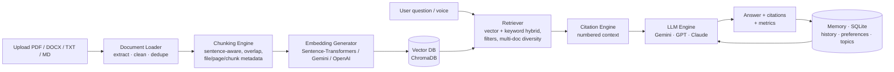

# 🧠 Personal AI Knowledge Assistant (RAG)

A personal ChatGPT for **your own knowledge**. Upload notes, PDFs, research papers and books. The assistant searches them semantically, answers questions with **page-level citations**, and turns your material into summaries, study notes, flashcards, quizzes and full exam-prep packs.

Built with **Python · Streamlit · FastAPI · ChromaDB · Sentence-Transformers · Groq / Gemini / OpenAI / Claude**.

---

## Problem statement

Students and professionals pile up class notes, papers, books and meeting notes. As that pile grows, finding the right piece of information by hand gets slow. This project uses **Retrieval-Augmented Generation (RAG)** to search, understand and answer questions from the user's own documents, and it cites exactly where every answer came from.

## Architecture



**Agent layer** (on top of the pipeline):

| Agent | Responsibility |
|---|---|
| Retrieval Agent | Topic search, document-name resolution ("summarize ResearchPaper.pdf"), multi-document retrieval |
| Summarization Agent | Summary → Key Findings → Recommendations (map-reduce for long documents) |
| Learning Agent | Chapter notes, revision guides, exam summaries, flashcards, MCQ and short-answer quizzes, answer grading |
| Exam-Prep Agent | *"Prepare me for my DBMS exam"* → topics, summary, quiz, flashcards and a day-by-day revision plan |
| Orchestrator | Reads the intent of each chat message and hands it to the right agent |

## Features

| Area | What's implemented |
|---|---|
| **MVP** | Upload PDF/DOCX/TXT/Markdown · list of uploaded files · semantic search · question answering with inline `[n]` citations (file + page) · persistent conversation history (questions, responses, retrieved sources) |
| **Intermediate** | Multi-document research and comparison tables · document summarization · study notes (Chapter Notes / Revision Guide / Exam Summary) · interactive flashcards (flip, mastery tracking, CSV/Anki export) · quiz generator (graded MCQs, short answers, practice tests) |
| **Advanced** | Personal knowledge base with categories (Education, Research, Projects, Notes) · voice assistant (speech → text → RAG → speech) · memory layer (preferences, past conversations, frequently accessed topics) · agent-based workflow · autonomous learning assistant |
| **Quality** | Hybrid retrieval (vector + keyword) · follow-up question rewriting from chat history · invalid-citation stripping · per-answer metrics (citation coverage, unsupported-sentence rate) · evaluation dashboard (hit rate@k, MRR, citation coverage, hallucination rate, LLM-as-judge quality) |
| **Engineering** | Streamlit UI · FastAPI REST backend · CLI · SQLite metadata · duplicate-upload detection · re-indexing · Docker, Render, Railway and Streamlit Cloud configs · unit and integration tests |

**Works without an API key.** With no key the app runs in *offline mode*: answers are built from the most relevant passages, and summaries, flashcards and quizzes come from heuristics. Add a free Groq (https://console.groq.com/keys) or Gemini key to get full generated answers. With both keys, the app switches to the other one automatically when a free-tier limit is hit.

## Installation

```bash
git clone https://github.com/<you>/personal-ai-assistant.git
cd personal-ai-assistant
python -m venv .venv
# Windows: .venv\Scripts\activate    macOS/Linux: source .venv/bin/activate
pip install -r requirements.txt          # full (includes sentence-transformers / PyTorch)
# or: pip install -r requirements-lite.txt   (no PyTorch – use Gemini/OpenAI embeddings)

cp .env.example .env                     # then paste your GEMINI_API_KEY (free: https://aistudio.google.com/apikey)
```

## Usage

```bash
python -m streamlit run app.py   # web app → http://localhost:8501
uvicorn api:app --reload      # REST API → http://localhost:8000/docs
python cli.py status          # CLI
```

**Quick demo:** open **📚 Knowledge Base → 🧪 Load sample docs**, then in **💬 Chat** try:

- `Explain overfitting using my materials`
- `Compare supervised and unsupervised learning`
- `Summarize operating_systems.txt`
- `Make flashcards on data structures`
- `Quiz me on process scheduling`
- `Prepare me for my operating systems exam in 3 days`

### Pages

| Page | What you do there |
|---|---|
| 🏠 Home | Ask a question straight away, quick actions, recent documents and chats, a 3-step start guide for new users |
| 💬 Ask | Chat with your notes; answers show highlighted citations and the passages used; speak a question or add a file without leaving the chat |
| 📚 My Library | Add documents, sort them into categories, search inside them, summarize, download or remove them |
| 🎓 Study | One place for summaries, notes, flashcards, quizzes and exam-prep plans; save anything you make |
| ⚙️ Settings | Answer style, AI keys, chat history, quality check and storage |

Technical details (similarity scores, retrieval tables, raw API errors) are hidden by default. Switch them on in **Settings → Answers**.

### REST API (FastAPI)

| Method | Endpoint | Description |
|---|---|---|
| GET | `/health` | Status, provider, counts |
| POST | `/documents` | Upload (multipart `file`, `category`) |
| GET / PATCH / DELETE | `/documents[/{doc_id}]` | List, recategorize, delete |
| POST | `/search` | Semantic search |
| POST | `/ask` | Chat with citations (`mode`: auto, qa, compare, summarize, notes, flashcards, quiz, exam_prep) |
| POST | `/summarize`, `/notes`, `/flashcards`, `/quiz`, `/quiz/grade`, `/exam-prep` | Study tools |
| GET / PUT | `/preferences`, GET `/topics`, `/conversations` | Memory layer |

## Configuration

All settings are environment variables (see `.env.example`):

- `LLM_PROVIDER`: `auto` | `groq` | `gemini` | `openai` | `anthropic` | `offline`
- `EMBEDDING_PROVIDER`: `auto` | `sentence-transformers` | `gemini` | `openai` | `hashing`. Changing it creates a new vector collection, so re-index from Settings afterwards.
- `VECTOR_STORE`: `auto` (ChromaDB) | `numpy` (built-in fallback)
- `CHUNK_SIZE`, `CHUNK_OVERLAP`, `TOP_K`, `HISTORY_TURNS`

## Project structure

```
personal-ai-assistant/
├── app.py                  # Streamlit web app
├── api.py                  # FastAPI backend
├── cli.py                  # command-line interface
├── requirements.txt / requirements-lite.txt / .env.example
├── src/
│   ├── config.py           # settings
│   ├── document_loader.py  # PDF/DOCX/TXT/MD extraction, cleaning, dedup
│   ├── chunker.py          # sentence-aware chunking + metadata
│   ├── embeddings.py       # sentence-transformers / Gemini / OpenAI / offline hashing
│   ├── vector_store.py     # ChromaDB + NumPy stores
│   ├── retriever.py        # hybrid semantic search
│   ├── llm_engine.py       # Gemini / OpenAI / Claude REST clients
│   ├── prompts.py          # prompt templates
│   ├── citation.py         # citation engine + faithfulness metrics
│   ├── chat.py             # KnowledgeAssistant orchestrator
│   ├── agents.py           # retrieval / summarization / learning / exam-prep agents
│   ├── offline.py          # no-key extractive generation
│   ├── memory.py           # SQLite: docs, conversations, preferences, topics
│   ├── voice.py            # speech-to-text / text-to-speech
│   └── evaluation.py       # retrieval & answer evaluation
├── data/ (uploads, embeddings, metadata)   vector_store/   outputs/   assets/
├── sample_data/            # demo documents + eval_set.json
└── tests/                  # unit + integration tests
```

## Testing

```bash
pytest                # or: python -m unittest discover -s tests -t .
```

- **Unit:** PDF/DOCX/TXT extraction, cleaning, deduplication, chunking, embeddings, vector store, citations
- **Integration:** upload → retrieval → cited response, agents, memory, API endpoints
- **LLM paths:** tested with a deterministic fake LLM, so no network is needed
- **AI evaluation:** `python cli.py evaluate sample_data/eval_set.json` or the 📊 page

## Deployment

- **Streamlit Community Cloud:** push to GitHub → new app → `app.py`. Rename `requirements-lite.txt` to `requirements.txt` (or pick it in advanced settings), then add `GEMINI_API_KEY` and `EMBEDDING_PROVIDER = "gemini"` under *Secrets*.
- **Render:** `render.yaml` defines the web app and the API.
- **Railway / Docker:** `docker build -t pka . && docker run -p 8501:8501 -e GEMINI_API_KEY=... pka` (set `APP=api` for the API).

> Free hosting tiers have short-lived disks. Uploaded documents are lost on restart unless you attach a persistent disk.

## Screenshots

Add screenshots of the Chat, Knowledge Base and Exam Prep pages to `assets/` and link them here.

## Roadmap

- React / Next.js frontend on the existing FastAPI backend
- Pinecone / Weaviate / Milvus vector stores; PostgreSQL + pgvector
- OCR for scanned PDFs; web-page and YouTube-transcript ingestion
- Cross-encoder re-ranking; streaming responses
- Multi-user accounts and authentication

## Resume statement

> Developed a Retrieval-Augmented Generation (RAG) based Personal AI Knowledge Assistant using Python, Streamlit, FastAPI, ChromaDB and the Gemini API, enabling semantic search, source-grounded question answering, document summarization, study-note, flashcard and quiz generation, multi-agent exam preparation, and citation-aware conversational retrieval across user-provided knowledge repositories.
